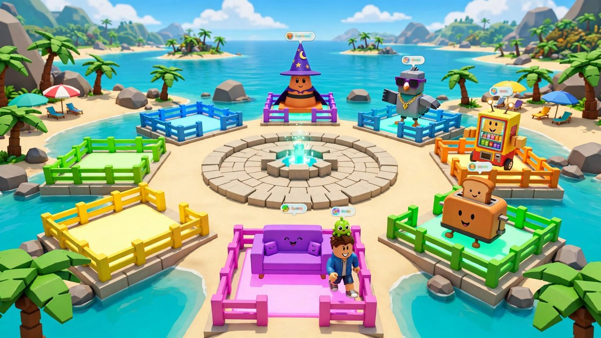

# Brainrot Bay — a Roblox brainrot game

*Concept art — what the game is designed to look like. This is a mockup, not a screenshot of the game running. The real screenshots come from Roblox Studio (see below).*

A 3D brainrot game for make.fun's "Make the best AI Roblox brainrot game" bounty (roblox-brainrot-01). Absurd
characters wash up on the beach around a tropical bay; you buy one, carry it home on your head, and place it on
your base, where it earns money every second. Rarer ones earn more. Other players can steal yours unless your
base is locked, and every few minutes the tide sweeps the whole map — anyone caught out in the open is washed
back to spawn and drops what they were carrying.

## The cast (all original, none borrowed)

Cone Wizard, Disco Pigeon, Vending Machine of Destiny, Sir Reginald the Toaster, Captain Couch, The WiFi Router
of Doom, Grandma's Wi-Fi Password, The Last Slice of Pizza, Chairman Meow and The Moon's Left Sock — on a ladder
of Common, Rare, Epic, Legendary and Mythic, with Golden (x2) and Diamond (x4) mutations.

## The loop

1. Brainrots spawn on the six pads around the plaza, each with a price tag.
2. Buy one (E), carry it home, place it on your base (Q or the prompt).
3. It earns $/s. Buy rarer ones, expand your base (+2 slots), lock it against thieves (L, 30s lock, 60s recharge).
4. Steal from unlocked bases — but carry your prize home before the tide, or its owner, catches you.
5. Rebirth at $10,000 lifetime earned: reset your money and base for a permanent +25% income per rebirth.
6. Golden Hour doubles all earnings for a minute, every five minutes.

## How it is built

- `main.ts` (Node 22, standard library only) hands the game in: it copies `game.rbxl`, `src/`, `screenshots/` and
  `PLAY.json` to `/output`, leaving out every name that starts with a dot (such as `.gitkeep` or `.DS_Store`, which
  fail an entry), and writes `/output/dossier.json` with `vendor/makefun-roblox.ts`, the kit's copy, unchanged.
- `game.rbxl` is the place Rojo builds from `src/` and `default.project.json` (`rojo build default.project.json
  --output game.rbxl`). The world is built in the project file: sand, the bay, the plaza, eight base plots, palms,
  rocks and umbrellas.
- `src/shared/` holds the tuning (`Config`) and the cast (`BrainrotData`). `src/server/` holds the economy,
  the bases (placement, locking, stealing, expansion), the spawner (pads, models, carrying) and the tide.
  `src/client/` holds the HUD, the keybinds and the feedback effects. State lives in one place on the server and
  reaches the HUD in a single `StateUpdate` remote.
- `screenshots/` currently holds the kit starter's three placeholder images (a grey square) — they are NOT the game. They are replaced with real captures of the game running in Roblox Studio before submitting; one of them becomes the thumbnail uploaded for the game on Roblox.
  `PLAY.json` names the published place (filled in once the game is published from Studio).
- `TOUR.json` is the optional tour: for each screenshot, the keys that bring the game to that screen.

Run it as the grader does, writing `out/` in place of `/output`:

    mkdir -p out && MAKEFUN_OUTPUT_DIR=out node main.ts

The rules are on the bounty's page (/bounty/roblox-brainrot-01) and in the kit's RULES.txt,
which gives every command in order (Before you submit, then Enter).
